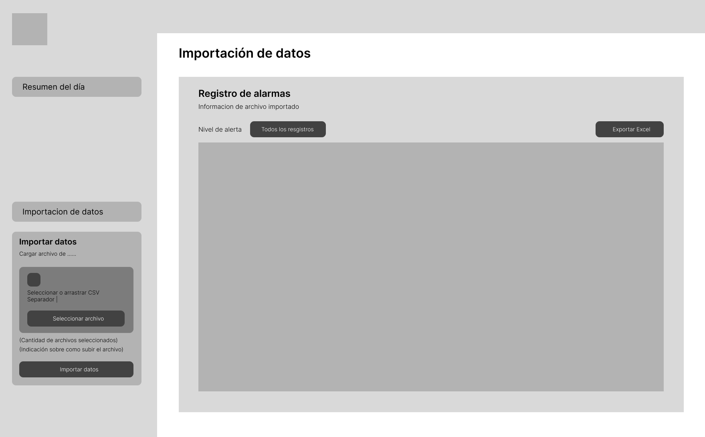
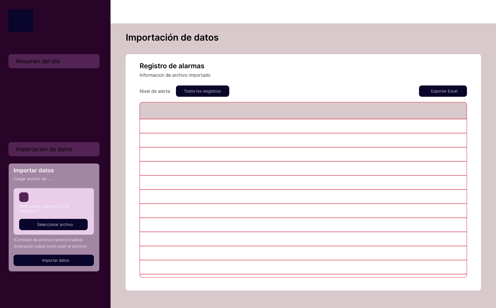
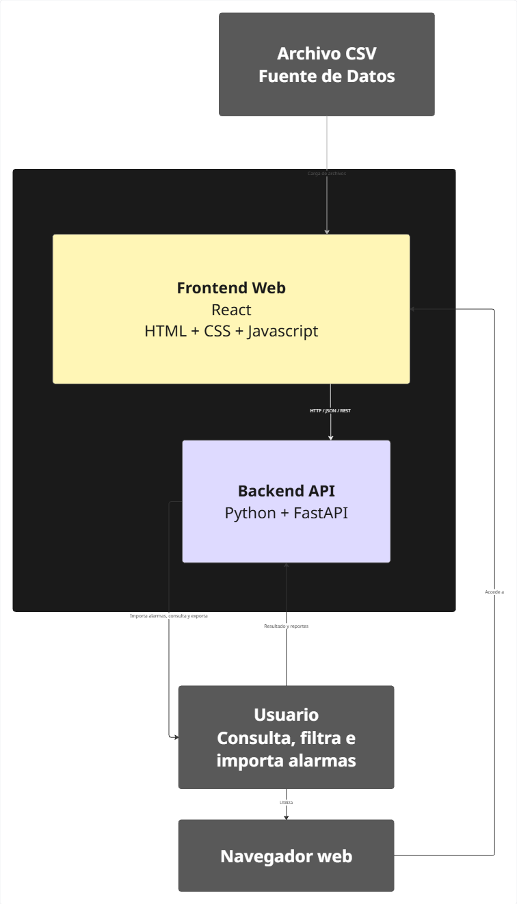
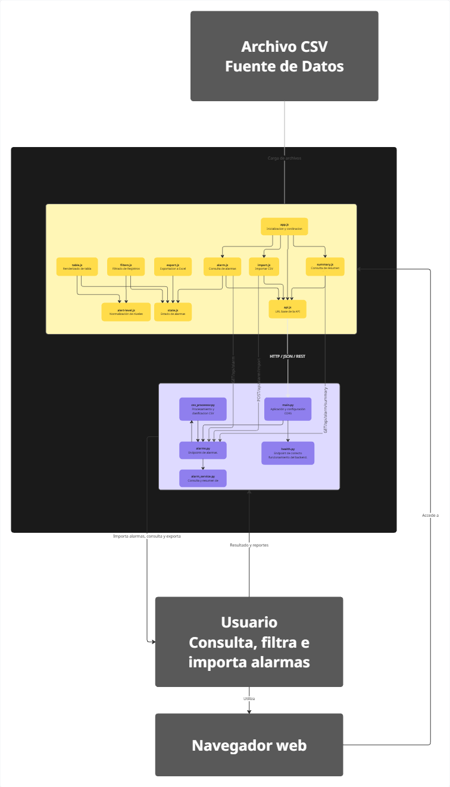

# Alarm Management System

<p align="center">
  <strong>A Full-Stack Web Application for Alarm Processing, Classification and Monitoring</strong>
</p>

<p align="center">
  <a href="https://hitsstest-web.vercel.app/">Live Application</a> •
  <a href="https://hitss-test.onrender.com/docs">API Documentation</a> •
  <a href="https://github.com/SalomonHernandezVelandia/HITSS_test">Source Code</a>
</p>

---

## Overview

**Alarm Management System** is a full-stack web application developed to import, process, classify, visualize and monitor network alarms through an interactive web interface.

The application processes alarm datasets provided in CSV format, applies business rules on the backend to determine alarm criticality, and presents the resulting information through a dynamic dashboard.

The system was designed around a decoupled architecture, separating the frontend and backend responsibilities and enabling communication through RESTful API services.

Its main objective is to transform raw alarm records into structured and actionable information, allowing users to identify critical events, monitor alarm durations, filter records, export information and analyze daily activity.

## Live Demo

| Component | URL |
|---|---|
| Frontend | [https://hitsstest-web.vercel.app/](https://hitsstest-web.vercel.app/) |
| Backend API | [https://hitss-test.onrender.com](https://hitss-test.onrender.com) |
| API Documentation | [FastAPI Swagger UI](https://hitss-test.onrender.com/docs) |
| Repository | [GitHub - HITSS_test](https://github.com/SalomonHernandezVelandia/HITSS_test) |

> **Note:** The backend is hosted on Render and the frontend on Vercel. Depending on the hosting service's availability and inactivity policies, the first backend request may take longer while the service starts.

---

## Table of Contents

- [System Architecture](#system-architecture)
- [Technology Stack](#technology-stack)
- [Project Structure](#project-structure)
- [Getting Started](#getting-started)
- [Environment Configuration](#environment-configuration)
- [API Reference](#api-reference)
- [Application Workflow](#application-workflow)
- [Visual Documentation](#visual-documentation)
- [Deployment](#deployment)
- [AI-Assisted Development](#ai-assisted-development)
- [Future Improvements](#future-improvements)


---

## System Architecture

The application follows a **decoupled frontend-backend architecture**.

The frontend is responsible for user interaction, data visualization, filtering and exporting. The backend exposes RESTful services, processes CSV files, executes business rules and provides aggregated information.

Communication between both layers is performed through HTTP requests using JSON responses and CSV request bodies where appropriate.


### Architectural Responsibilities

| Layer | Responsibility |
|---|---|
| Frontend | User interface, interaction, filtering, visualization and Excel export. |
| API | HTTP communication between the frontend and backend. |
| Backend | Request validation, CSV processing, business logic and data aggregation. |
| Services | Reusable data processing and alarm management operations. |

---

## Technology Stack

### Backend

| Technology | Purpose |
|---|---|
| Python | Main backend programming language. |
| FastAPI | REST API development and request handling. |
| Uvicorn | ASGI server for running the application. |
| Pandas | CSV processing, data manipulation and aggregation. |

### Frontend

| Technology | Purpose |
|---|---|
| HTML5 | Application structure. |
| SCSS | Styling and interface design. |
| JavaScript (ES Modules) | Application logic, API consumption and dynamic rendering. |

### Infrastructure and Deployment

| Technology | Purpose |
|---|---|
| Git | Version control. |
| GitHub | Source code repository. |
| Render | Backend hosting. |
| Vercel | Frontend hosting. |
| REST API | Communication between frontend and backend. |

---

## Project Structure

The repository is organized into two main applications: `backend` and `web`.

### Backend Modules

**`main.py`**

Initializes the FastAPI application, configures CORS and registers the API routers.

**`routers/alarms.py`**

Defines the alarm-related endpoints, including CSV import, alarm retrieval and daily summary requests.

**`routers/health.py`**

Provides a health-check endpoint to verify backend availability.

**`services/csv_processor.py`**

Handles CSV reading, column normalization, data cleaning, duration calculation and alert classification.

**`services/alarm_service.py`**

Manages imported alarm data and provides processed records and daily aggregated information.

### Frontend Modules

**`app.js`**

Coordinates application initialization and backend connectivity.

**`config/api.js`**

Centralizes the backend API base URL.

**`modules/import.js`**

Handles CSV selection, validation and upload requests.

**`modules/alarms.js`**

Retrieves alarm information and manages automatic data polling.

**`modules/alert-level.js`**

Normalizes alert classification values for frontend rendering.

**`modules/filters.js`**

Applies the selected alert-level filters.

**`modules/table.js`**

Dynamically generates the alarm table and its visual indicators.

**`modules/summary.js`**

Retrieves and renders daily aggregated information.

**`modules/export.js`**

Exports the currently visible records to Excel.

**`modules/state.js`**

Maintains the application data state and visible records.

---

## Getting Started

Follow these instructions to run the application locally.

### Prerequisites

Make sure the following tools are installed:

- Python 3.10 or newer.
- pip.
- Git.
- Visual Studio Code (recommended).
- Live Server extension for Visual Studio Code (recommended).

### 1. Clone the Repository

Open a terminal and execute:

```bash
git clone https://github.com/SalomonHernandezVelandia/HITSS_test.git
```

Navigate to the project directory:

```bash
cd HITSS_test
```

### 2. Backend Setup

The backend requires a Python virtual environment and the dependencies listed in `backend/requirements.txt`.

From the project root, create the virtual environment:

```bash
python -m venv .venv
```

Activate it on Windows PowerShell:

```powershell
.\.venv\Scripts\Activate.ps1
```

If PowerShell blocks script execution, you may temporarily allow local scripts for the current terminal session:

```powershell
Set-ExecutionPolicy -Scope Process -ExecutionPolicy Bypass
```

Then activate the environment again:

```powershell
.\.venv\Scripts\Activate.ps1
```

Install the backend dependencies:

```bash
pip install -r backend/requirements.txt
```

Navigate to the backend directory:

```bash
cd backend
```

Start the FastAPI development server:

```bash
uvicorn main:app --reload
```

The backend will be available at:

```text
http://127.0.0.1:8000
```

Interactive API documentation:

```text
http://127.0.0.1:8000/docs
```

**Important:** Keep this terminal running while using the application.

### 3. Frontend Setup

Open a second terminal in Visual Studio Code.

Navigate to the frontend directory from the project root:

```bash
cd web
```

Open `index.html` with the Live Server extension.

Configure Live Server to use port `5500`.

The frontend should be available at:

```text
http://127.0.0.1:5500
```

**Alternative:** If Live Server is not installed, you can serve the static frontend with Python:

```bash
python -m http.server 5500
```

Run this command from inside the `web` directory.

Keep the frontend server running in the second terminal.

### 4. Verify the Application

Once both servers are running:

1. Open the frontend in your browser.
2. Verify that the backend connection is successful.
3. Select a CSV file.
4. Import the dataset.
5. Review the processed alarm records.
6. Test the filters and alert indicators.
7. Open the daily summary.
8. Export the currently visible records to Excel.

---

## Environment Configuration

The backend API URL is centralized in:

```text
web/js/config/api.js
```

This file must point to the correct backend depending on the execution environment.

### Local Development

When running the backend locally:

```javascript
export const API_URL = "http://127.0.0.1:8000/api";
```

### Production

When using the deployed backend on Render:

```javascript
export const API_URL = "https://hitss-test.onrender.com/api";
```

> **Important:** Change this URL before running the application in the corresponding environment. The frontend must communicate with the backend URL that is actually running.

### CORS Configuration

The backend configures Cross-Origin Resource Sharing in:

```text
backend/main.py
```

The current configuration allows requests from the production frontend and the local development server:

```python
app.add_middleware(
    CORSMiddleware,
    allow_origins=[
        "https://hitsstest-web.vercel.app",
        "http://localhost:5500"
    ],
    allow_credentials=True,
    allow_methods=["*"],
    allow_headers=["*"],
)
```

If the frontend is served from a different origin or port, update `allow_origins` accordingly.

---

## API Reference

The backend exposes the following RESTful endpoints.

Base URL:

```text
https://hitss-test.onrender.com
```

| Method | Endpoint | Description |
|---|---|---|
| GET | `/api/health` | Checks backend availability. |
| POST | `/api/alarms/import` | Imports and processes a CSV dataset. |
| GET | `/api/alarms` | Retrieves processed alarm records. |
| GET | `/api/alarms/summary/today` | Retrieves the current day's alarm aggregation. |

### 1. Health Check

**GET** `/api/health`

Checks whether the backend is running.

Example response:

```json
{
  "status": "ok",
  "message": "Backend funcionando correctamente"
}
```

### 2. Import Alarms

**POST** `/api/alarms/import`

Receives a CSV file as the raw HTTP request body.

Headers:

```text
Content-Type: text/csv
X-Filename: alarmas.csv
```

The CSV must use `|` as its delimiter.

Example response:

```json
{
  "message": "Archivo importado correctamente",
  "filename": "alarmas.csv",
  "total_records": 150,
  "columns": [
    "FECHA_CREACION",
    "NOTIFICADA",
    "2G",
    "3G",
    "4G"
  ]
}
```

The number of records and columns depend on the uploaded dataset.

### 3. Retrieve Alarms

**GET** `/api/alarms`

Returns processed alarm information, including the calculated duration and alert classification.

Example response structure:

```json
{
  "total": 150,
  "columns": [
    "FECHA_CREACION",
    "NOTIFICADA",
    "2G",
    "3G",
    "4G",
    "DURACION_ACUMULADA",
    "ALERT_LEVEL"
  ],
  "data": [
    {
      "FECHA_CREACION": "01-JAN-26 10.30.00.000 AM",
      "NOTIFICADA": "N",
      "2G": 100,
      "3G": 80,
      "4G": 75,
      "DURACION_ACUMULADA": "0d 2h 30m 0s",
      "ALERT_LEVEL": "WARN"
    }
  ]
}
```

### 4. Daily Summary

**GET** `/api/alarms/summary/today`

Returns the total number of alarms created on the current day and their hourly distribution.

Example response structure:

```json
{
  "date": "2026-11-08",
  "total": 12,
  "hours": [
    {
      "hour": "00:00",
      "count": 0
    },
    {
      "hour": "01:00",
      "count": 2
    },
    {
      "hour": "02:00",
      "count": 1
    }
  ]
}
```

The response contains all 24 hourly intervals, including those with zero alarms.

For complete endpoint exploration, access:

[FastAPI Interactive Documentation](https://hitss-test.onrender.com/docs)

---

## Application Workflow

The main application workflow can be summarized as follows:

1. The user selects a CSV file through the frontend.
2. The frontend sends the file contents to the backend.
3. FastAPI receives the request and validates the filename and content.
4. Pandas processes the CSV dataset.
5. The backend calculates accumulated alarm durations.
6. Business rules determine the corresponding alert classification.
7. The processed records are returned through the API.
8. JavaScript updates the dashboard and renders the alarm table.
9. Users can filter records, consult the daily summary and export the visible data.

The frontend and backend remain independent components throughout this process.

---

## Visual Documentation

This section contains the visual artifacts used during the design and architectural documentation of the system.

Replace the image paths below with the actual locations of your diagrams and wireframes inside the repository.

### **Wireframes**

The following section is reserved for the initial interface wireframes.

These diagrams illustrate the planned layout, component distribution and user interaction flow.

<table>
  <tr>
    <td align="center" width="50%">
      
      <br>
      <em>Main dashboard wireframe.</em>
    </td>
    <td align="center" width="50%">
      
      <br>
      <em>Daily summary wireframe.</em>
    </td>
  </tr>
</table>

### **C4 Model - software architecture**

The architecture is documented using the C4 model, describing the system at different levels of abstraction.

<table>
  <tr>
    <td align="center" width="50%">
      <strong>C2 — Container Diagram</strong>
      <br><br>
      
      <br>
      <em>Explains the internal components of the application and their responsibilities.</em>
    </td>
    <td align="center" width="50%">
      <strong>C3 — Component Diagram</strong>
      <br><br>
      
      <br>
      <em>Provides a detailed representation of the internal code structure and its relationships.</em>
    </td>
  </tr>
</table>

#### C1 — System Context Diagram

Shows the system in its environment, identifying its users and external dependencies.

#### C2 — Container Diagram

Describes the main application containers and how they communicate.

#### C3 — Component Diagram

Explains the internal components of the application and their responsibilities.


#### C4 — Code Diagram

Provides a more detailed representation of the internal code structure and the relationships between relevant implementation elements.


> **Documentation note:** Store the corresponding images in the paths indicated above, or update the Markdown image references to match your actual filenames.

---

## Deployment

The application is deployed using separate hosting platforms for each layer.

### Frontend — Vercel

The static frontend is deployed on Vercel.

Production URL:

[https://hitsstest-web.vercel.app/](https://hitsstest-web.vercel.app/)

The Vercel project uses the `web` directory as its root directory.

### Backend — Render

The FastAPI backend is deployed on Render.

Production URL:

[https://hitss-test.onrender.com](https://hitss-test.onrender.com)

Backend deployment configuration:

| Setting | Value |
|---|---|
| Root Directory | `backend` |
| Build Command | `pip install -r requirements.txt` |
| Start Command | `uvicorn main:app --host 0.0.0.0 --port $PORT` |

The frontend communicates with the deployed backend through the production API URL configured in `web/js/config/api.js`.

---

## Author

**Salomón Hernández Velandia**

Full-Stack Development | Python | FastAPI | JavaScript | Data Processing

- GitHub: [SalomonHernandezVelandia](https://github.com/SalomonHernandezVelandia)
- Project Repository: [HITSS_test](https://github.com/SalomonHernandezVelandia/HITSS_test)

---

<p align="center">
  <strong>Alarm Management System</strong><br>
  Full-Stack Technical Assessment
</p>